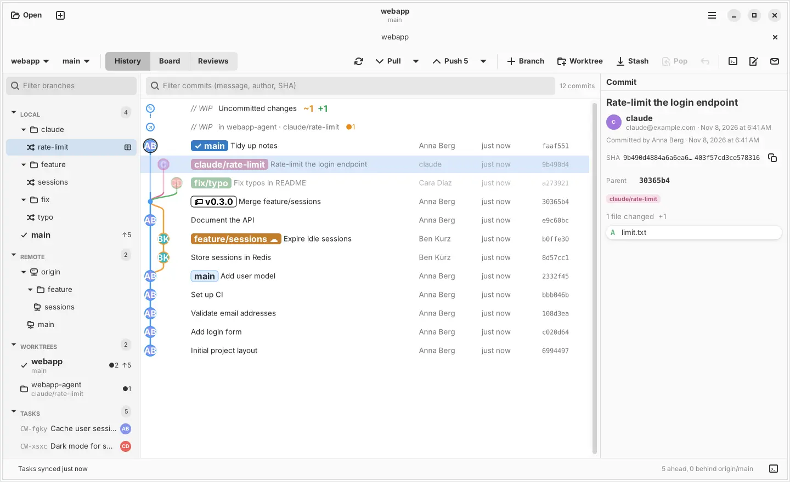
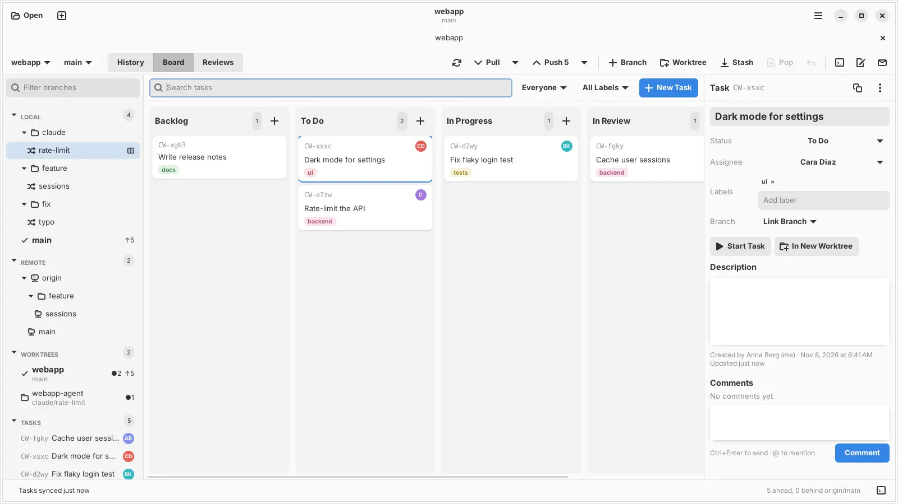

<p align="center">
  
</p>

<h1 align="center">git-cowork for Linux</h1>

<p align="center">
  A small, fast, native Linux git client — with a task board and code reviews that live inside your repo.<br>
  No sign-up. No server. No telemetry. Just <code>git</code>.
</p>

<p align="center">
  <a href="https://github.com/hanneseilers/git-cowork-linux/actions/workflows/linux.yml"></a>
  
  
  
  
  <a href="LICENSE"></a>
</p>

<p align="center">
  
</p>

git-cowork was originally written for macOS
([michael-smao/git-cowork](https://github.com/michael-smao/git-cowork);
its README: [README-macos.md](README-macos.md)). This is its Linux version.

## Why

Most git GUIs are either heavy Electron apps or thin wrappers that hide what
git is doing. git-cowork is a native GTK 4 + libadwaita app that runs plain
`git` underneath and shows you every command it runs.

It's made for how many teams work now: lots of branches and worktrees in
parallel. You see all of them in one graph, with their uncommitted changes,
and you can hand out and review work without leaving the repo.

- **Fast and light.** 0% CPU when idle: no polling, the working tree is
  watched with inotify and only refreshed when something changes.
- **Just git.** Every action is a normal git command, visible in the command
  log (Ctrl+J). Your SSH keys, credential helpers, hooks and commit signing
  work exactly as in the terminal.
- **Always current.** Fetches every open repository in the background every
  5 minutes while the app is in front, so remote branches and ahead/behind
  are up to date before you pull. It never asks for a password; turn it off
  in Settings (Ctrl+,) › Git.
- **Worktrees first.** Every worktree shows in the sidebar and the graph,
  with live uncommitted counts and ahead/behind.
- **Tasks and reviews in the repo.** A shared board and review requests,
  stored on a hidden git ref and synced with plain `git push`/`fetch`.
  Works with GitHub, GitLab, Gitea, Forgejo or any git server.

<p align="center">
  
</p>

## Install

Debian 13 or newer, Ubuntu 24.04 or newer (or another distribution with
GTK ≥ 4.12 and libadwaita ≥ 1.5), x86_64 or aarch64. One line in a
terminal, no sudo:

```bash
curl -fsSL https://raw.githubusercontent.com/hanneseilers/git-cowork-linux/main/install-linux.sh | bash
```

It downloads the newest release, checks its SHA-256, and installs into
`~/.local`: the app (`git-cowork-gtk`), the `git cowork` command, a desktop
entry and the icon. No Swift needed. **Updates**: the app checks once a day
and shows "Update to x.y.z" in the status bar; one click installs it. Or run
the same line again. Missing libraries? `sudo apt install libgtk-4-1 libadwaita-1-0 libsecret-1-0 git`.

**As a package**: download `git-cowork_<version>_amd64.deb` (or `_arm64`)
from [Releases](https://github.com/hanneseilers/git-cowork-linux/releases)
and run `sudo apt install ./git-cowork_*.deb`. apt then handles updates.

**From source** (to change the code or follow `main`), with Swift 6.1+
([swift.org](https://www.swift.org/install/linux/)):

```bash
git clone https://github.com/hanneseilers/git-cowork-linux.git && cd git-cowork-linux
make deps                       # GTK 4, libadwaita, libsecret headers (apt, needs sudo)
make install                    # builds and installs into ~/.local (PREFIX=/usr/local for all users)
make update                     # later: pull, rebuild, reinstall
make uninstall
```

To save account tokens and SSH key passphrases, git-cowork uses the
desktop's Secret Service: GNOME Keyring, KWallet or KeePassXC. Everything
else works without one. **[docs/LINUX.md](docs/LINUX.md)** has the details:
requirements, settings, where data is kept, and troubleshooting.

### Versions

Releases follow [Semantic Versioning](https://semver.org) and are tagged
`vX.Y.Z`; see [Releases](https://github.com/hanneseilers/git-cowork-linux/releases) and
[CHANGELOG.md](CHANGELOG.md). **About git-cowork** (main menu) shows your
version and the commit it was built from, e.g. "Version 0.2.0 (1448777)".

### Open a repo from the terminal

```bash
git-cowork-gtk .
```

Or add `alias gk=git-cowork-gtk` to `~/.bashrc` and run `gk .`. If the app
is already running, the folder opens there as a new tab. You can also start
git-cowork from your app menu and drop a folder onto any window.

## Features

| Area | |
|---|---|
| **Tabs** | Every repo or worktree is a tab; Ctrl+T opens a new one. |
| **Toolbar** | Repository and branch pickers (switch worktrees, recent repos, checkout), History / Board / Reviews, Pull ▾ (fetch all, ff-only, rebase, merge), Push ▾ (sets upstream; force-with-lease asks first), Branch, Worktree, Stash, Pop, Undo, Terminal, Editor, Inbox. |
| **Sidebar** | Local, remote, worktrees, tasks, reviews, stashes, tags and team, with counts. Branch folders (`claude/…`, `codex/…`) open by default. Filter with Ctrl+Alt+F. |
| **Graph** | Lane-colored rows, author initials in nodes, branch badges on their commit, commits outside the current branch dimmed. A `// WIP` row above HEAD, plus one for every other worktree with uncommitted changes. |
| **Commit panel** | Message, author and co-authors, parents, refs, changed files. |
| **Changes panel** | Unstaged / staged / conflicts, stage per file or all, discard, commit, amend. |
| **Diff** | Hunk or split view, intra-line highlights, stage / unstage / discard single hunks. |
| **Merge / rebase** | Banner with Continue / Skip / Abort, conflicted files, "use mine / theirs". |
| **Hosts** | "Create pull/merge request" and "Open on …" for GitHub, GitLab, Gitea and Forgejo, including self-hosted. |
| **Clone** | Paste a URL, or, with an account added, pick from a filterable list of your repositories and your organizations' or groups'. |
| **Undo** | Ctrl+Z takes back the last commit, amend, reset, checkout or branch delete, with plain git commands. Not offered once you've pushed. |
| **Accounts** | Optional. Paste an access token for GitHub, GitLab, Gitea or Forgejo, and HTTPS push and pull just work. Browser sign-in (OAuth device flow) works too once you register an OAuth app for it. Tokens stay in the Secret Service and only git-cowork uses them. For SSH remotes, Create SSH Key makes a key, adds it to your GitHub or GitLab account and uses it in git-cowork without touching `~/.ssh/config`. |
| **Board** | Shared tasks in Backlog / To Do / In Progress / In Review / Done, with assignee, labels, linked branch and comments; drag cards between columns. "Start Task" creates the branch here; "In New Worktree" gives it its own folder and tab (handy for agents). Filter by person or label; Ctrl+Alt+← / → move the selected task. |
| **Reviews** | Review requests for a branch: reviewers, verdicts (approved / changes requested), comments, and the branch's changes. |
| **Inbox** | Tasks assigned to you, review requests, verdicts, @mentions and replies — also as desktop notifications. |

Right-click works almost everywhere: branches, commits, worktrees, files.

The app speaks **English and German** and follows your desktop's language
(`LANGUAGE`, `LC_MESSAGES`, `LANG`). `GIT_COWORK_LANG=en` picks one for
git-cowork only.

## How tasks and reviews work

Tasks, the backlog, review requests and comments are small Markdown files on
a hidden ref, `refs/cowork/main`, in the repository itself. They're pushed
and fetched with plain git like any other ref — no extra service, token or
account.

- **Teammates get it by opening the repo in git-cowork** (on Linux or on a
  Mac). Nothing to set up.
- **Sync** runs about once a minute while the app is in front, every 3
  minutes in the background (so notifications still arrive), and when you
  switch back to it. Click "Tasks synced …" in the status bar to sync now.
  Notifications need the app to be running; there is no push server.
- **Your identity** is `git config user.email`. Repository menu › Edit Team…
  gives people names and @handles for mentions.
- **It never touches your work.** The ref is written with git plumbing into a
  temporary index: no checkout, no change to your branches, index or working
  tree, and it doesn't show up in `git branch -a`.
- **Readable without the app:**
  `git fetch origin refs/cowork/main` and
  `git show refs/cowork/main:tasks/<id>.md`.
- Settings (Ctrl+,) › Git picks the remote to sync with and can turn
  automatic sync off.

Custom refs aren't shown in your host's web UI, so tasks are visible in
git-cowork and with plain git only.

### From the terminal: `git cowork`

The install puts a small command-line tool on your PATH (`git-cowork`, so
git runs it as `git cowork`). It works on the same tasks as the app, so
people and coding agents can use it side by side. Changes sync right away;
add `--json` for scripts and agents.

```bash
git cowork list --mine                   # my open tasks
git cowork new "Rate-limit the API" --assign me --label backend
git cowork start CW-a3f9 --worktree      # branch + own folder, task → In Progress
git cowork comment CW-a3f9 "Done, see branch"
git cowork review CW-a3f9-rate-limit --to anna@example.com
git cowork reviews --waiting             # reviews asked of me
git cowork approve R-7k2p "Looks good"
git cowork inbox --sync
```

`git cowork help` lists everything. Reads use what's already fetched; add
`--sync` to fetch teammates' changes first. The remote is `origin` unless
`git config cowork.remote <name>` says otherwise. Only the tool:
`make install-cli`.

## Keyboard shortcuts

| | |
|---|---|
| Ctrl+O / Ctrl+Shift+O | Open / clone repository |
| Ctrl+T / Ctrl+W | New tab / close tab |
| Ctrl+1 / Ctrl+2 / Ctrl+3 | History / Board / Reviews |
| Ctrl+Shift+T | New task |
| Ctrl+Shift+R | Request review of the current branch |
| Ctrl+F / Ctrl+Alt+F | Filter commits / filter branches |
| Ctrl+R | Refresh |
| Ctrl+Shift+F | Fetch all |
| Ctrl+Shift+L / Ctrl+Shift+P | Pull / push |
| Ctrl+Shift+B | New branch |
| Ctrl+Shift+S / Ctrl+Alt+Shift+S | Stash / pop |
| Ctrl+0 | Uncommitted changes |
| Ctrl+Enter | Commit |
| Esc | Close the diff |
| Ctrl+Alt+T / Ctrl+Alt+E | Open in terminal / editor |
| Ctrl+Z | Undo the last git action |
| Ctrl+Alt+← / Ctrl+Alt+→ | Move the selected task to the previous / next column |
| Ctrl+J | Command log |
| Ctrl+, | Settings |
| Ctrl+? | All shortcuts |

The editor and terminal are set in Settings (Ctrl+,) as commands, e.g.
`code`, `zed`, `gnome-terminal` or `kgx`; empty picks the first one installed.

## FAQ

**Which distributions?** Debian 13+ and Ubuntu 24.04+ are built and tested
(x86_64 and aarch64). Other distributions with GTK ≥ 4.12, libadwaita ≥ 1.5,
libsecret and git should work with the tarball or a source build. Windows
isn't supported.

**Does it work on KDE, Xfce, …?** Yes, it's a GTK 4 app and runs on any
desktop, X11 or Wayland. For saving tokens you need a Secret Service:
GNOME Keyring, KWallet (5.97+) or KeePassXC with its Secret Service
integration.

**Does it use AI?** No. It's a plain git client.

**Do I need Swift?** Only to build from source. The releases and the `.deb`
carry the Swift runtime inside the binaries.

**Is it free?** Yes. MIT license, no subscription, no seat limit.

**Is my data sent anywhere?** No telemetry, no server of ours. The app talks
to your git remotes through your own `git`. If you add an account, it also
calls that host's API (GitHub, GitLab, Gitea or Forgejo) to check the token,
list your repositories and upload an SSH key you create. Once a day it asks
GitHub for the newest release (turn it off in Settings). Tokens stay in your
Secret Service and are never written to a file.

**Does browser sign-in work out of the box?** Not yet: it needs an OAuth app
registered on the host. Use an access token, or register your own app as
Settings › Accounts describes.

**Can I work with teammates on a Mac?** Yes. Tasks, reviews and comments use
the same format on `refs/cowork/main`, so Linux and macOS users share one
board.

## Development

```bash
make run                  # debug build, run from the terminal
make test                 # unit tests (parsers, graph layout, diff, host links, cowork, Linux platform)
make e2e                  # end-to-end: keyring, ssh askpass, git cowork, the app under Xvfb
make app                  # dist/linux/git-cowork-<version>-linux-<arch> and its .tar.gz
make deb                  # .deb package
make version              # print the version
make check-translations   # UI text without a German translation
make sync-upstream        # merge changes from the original macOS repository
```

Swift and the GTK 4 / libadwaita / libsecret headers, nothing else: no
bindings library, no other dependencies.

```
Sources/GitCoworkCore/   pure logic: parsers, graph lane layout, diff, host links,
                         cowork file format, merge and inbox (tested)
Sources/CoworkKit/       reads, writes and syncs refs/cowork/main; the edits (new task,
                         comment, review, verdict); shared by the app and the tool (tested)
Sources/GitCoworkCLI/    the `git cowork` command-line tool
Sources/GitCoworkLinux/
  Platform/              main loop integration, translations, inotify file watching,
                         Secret Service, notifications, terminal/editor launch, SSH keys
  Gtk/                   thin Swift layer over the GTK 4 / libadwaita C API, Cairo/Pango drawing
  UI/                    window and tabs, toolbar, sidebar, history graph, inspector, diff,
                         board, reviews, inbox, settings, accounts, clone
Sources/GitCowork/       the model shared with the macOS app (repository state, git actions,
                         cowork store, accounts), compiled into the Linux app unchanged
Sources/CGtk/            module map for GTK 4, libadwaita and libsecret
Scripts/linux/           build, install, .deb, end-to-end tests, upstream sync
Resources/               translations (de.lproj, linux/de.lproj), icon, desktop entry
```

How it stays light:
- No polling of the working tree. inotify watches the worktrees and the git
  dir (skipping ignored folders); refreshes are debounced and merged.
- Swift concurrency runs on GTK's main loop through libdispatch's eventfd,
  so an idle app does nothing at all.
- `GIT_OPTIONAL_LOCKS=0`, so the app's own `git status` doesn't rewrite the
  index and trigger another refresh.
- History reloads only when refs, HEAD or stashes actually change, and the
  graph draws only the visible rows.

How the port works and how changes from the original repository are
merged in: [docs/LINUX.md](docs/LINUX.md).

## Contributing

Bug reports, ideas and pull requests are welcome. See
[CONTRIBUTING.md](CONTRIBUTING.md) for guidelines and debug aids, and
[PLAN.md](PLAN.md) for the design. Please follow the
[code of conduct](CODE_OF_CONDUCT.md), and report security problems
privately as described in [SECURITY.md](SECURITY.md).

## License

[MIT](LICENSE) © 2026 smao GmbH
